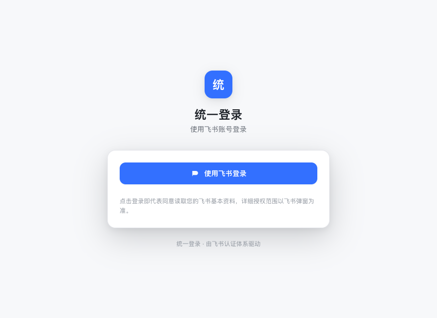
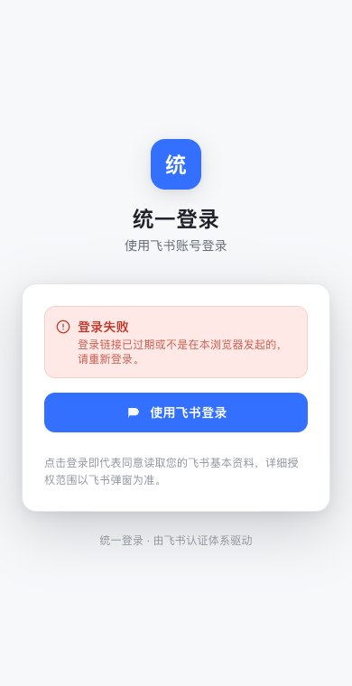
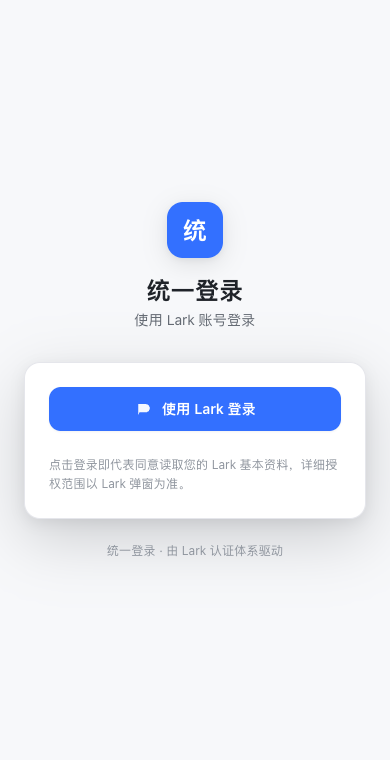
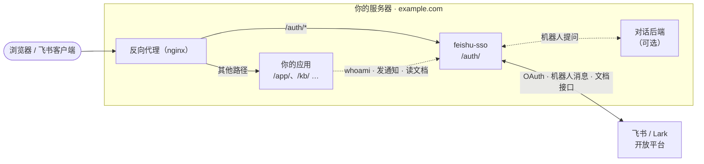
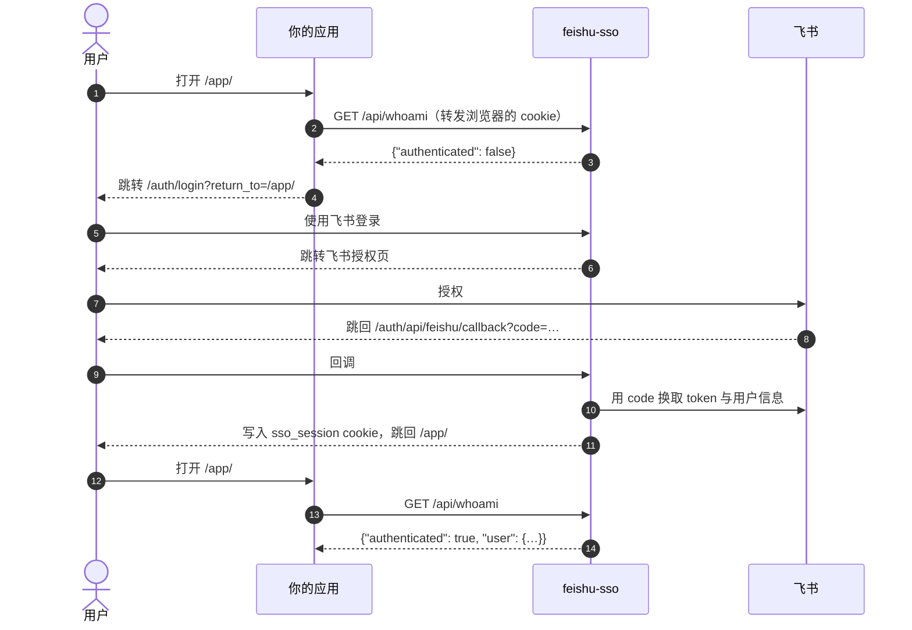
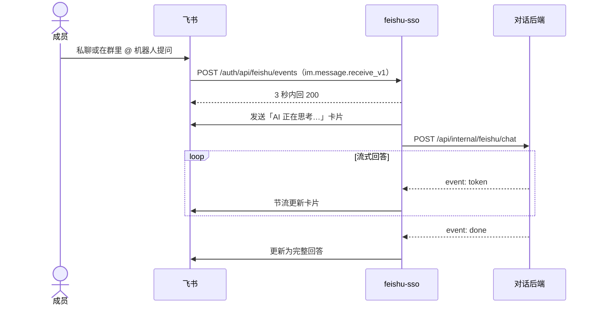

# feishu-sso

[English](README.md) | 简体中文

飞书统一登录服务：让你自建的多个网页应用共用一套飞书登录。用户在登录页用飞书授权一次，同域名下的所有应用都能通过 `whoami` 拿到当前用户。另外附带接入方常用的飞书能力，让业务应用不必各自持有飞书凭证。



## 功能

- **飞书登录**：OAuth 授权、30 天滑动会话；在飞书客户端内打开时自动登录
- **身份查询**：`GET /auth/api/whoami` 返回当前用户（姓名、头像、邮箱、手机号等）
- **发通知**：业务服务凭共享口令，以机器人身份给某人或某个群发卡片
- **读飞书文档**：以当前登录用户的身份读取云文档、知识库、多维表格、电子表格、画板，飞书负责权限判断
- **飞书机器人（可选）**：私聊或群里 @ 机器人提问，卡片流式回答；回答由你接入的对话后端生成
- **中英双语**：登录页跟随浏览器语言，也可用 `?lang=zh|en` 指定；机器人文案用 `BOT_LANG` 切换
- **飞书与 Lark**：默认对接飞书中国版，`FEISHU_DOMAIN=lark` 切换到国际版 Lark

| 手机端 | 登录失败提示 | Lark 模式 |
| :---: | :---: | :---: |
|  |  |  |

同系列的 media-compress、multi-model-chat、ai-resume-screener 等应用都能以可选方式接入它。

技术栈：Fastify + Prisma（SQLite）后端，React + Vite + Tailwind 登录页，pnpm workspace 管理。

## 工作原理

feishu-sso 与你的应用部署在同一个域名下：反向代理把 `/auth/*` 转给它，其余路径转给你的应用，所有应用因此共用同一个登录 cookie。



接入方视角的登录流程：



在飞书客户端内打开时，登录页会自动发起授权，用户只会看到一次短暂的跳转。

## 快速开始

需要 Node.js ≥ 20.19（推荐 22 或 24）和 pnpm 9，以及一个飞书自建应用（创建步骤见下文）。

```bash
pnpm install     # 安装依赖并生成 Prisma client
pnpm bootstrap   # 复制 api/.env.example → api/.env.dev，生成 AUTH_DATA_KEY，并创建本地 SQLite 数据库
# 编辑 api/.env.dev，填入 FEISHU_APP_ID 和 FEISHU_APP_SECRET
pnpm dev         # 同时启动 api（:4020）和登录页（:5020）
```

打开 <http://localhost:5020/auth/login>，点「使用飞书登录」完成授权后，访问 <http://localhost:5020/auth/api/whoami> 能看到自己的用户信息。

登录页固定挂在 `/auth/` 路径下，接口在 `/auth/api/*`。本地开发时 Vite 把 `/auth/api/*` 转发给 api 的 `/api/*`，与生产环境的反向代理一致。

数据库在 `api/prisma/dev.db`，已被 git 忽略。飞书的 access token 和 refresh token 落库前用 `AUTH_DATA_KEY` 加密。

## 常用命令

| 命令 | 作用 |
| --- | --- |
| `pnpm dev` | 本地开发 |
| `pnpm build` | 构建 api（`api/dist`）和登录页（`web/dist`） |
| `pnpm typecheck` | 全部包类型检查 |
| `pnpm test` | 全部单元测试 |
| `pnpm --filter @feishu-sso/api db:migrate` | 修改 `api/prisma/schema.prisma` 后生成并应用迁移 |

## 创建飞书应用

在[飞书开放平台](https://open.feishu.cn/app)（Lark 用户在 [Lark 开放平台](https://open.larksuite.com/app)）创建一个**企业自建应用**，然后：

1. **凭证**：「凭证与基础信息」里的 App ID、App Secret 填到 `FEISHU_APP_ID`、`FEISHU_APP_SECRET`。
2. **网页应用与重定向 URL**：在「应用能力」里添加「网页应用」；在「安全设置 → 重定向 URL」里登记回调地址，必须与 `FEISHU_REDIRECT_URI` 一字不差（含 http / https、端口、路径）：
   - 本地开发：`http://localhost:5020/auth/api/feishu/callback`
   - 生产：`https://<你的域名>/auth/api/feishu/callback`
3. **权限**：在「权限管理」开通 `FEISHU_SCOPES` 里列出的权限。只要登录的话，有 `contact:user.base:readonly` 即可；邮箱、手机号、读文档等按需开通，并同步修改 `FEISHU_SCOPES`。
4. **发布**：在「版本管理与发布」创建版本并发布，等企业管理员审核通过；权限改动也要发新版本才生效。另外在「可用范围」里加入需要登录的成员。

`FEISHU_SCOPES` 比用户上次登录时多出新权限时，已登录用户会被要求重新登录一次，以便授权新权限。

使用 **Lark** 时设置 `FEISHU_DOMAIN=lark`：授权页改用 `passport.larksuite.com`，开放接口改用 `open.larksuite.com`，路径和后台配置与飞书一致。

## 配置

api 用 Node 原生的 `--env-file` 加载配置：`pnpm dev` 读 `api/.env.dev`，`pnpm start` 读 `api/.env.prod`。两者都不入库，模板是 [`api/.env.example`](api/.env.example)。

| 变量 | 默认 | 说明 |
| --- | --- | --- |
| `FEISHU_DOMAIN` | `feishu` | `feishu` 为飞书中国版，`lark` 为国际版 Lark |
| `FEISHU_APP_ID` / `FEISHU_APP_SECRET` | — | 飞书应用凭证，必填 |
| `FEISHU_REDIRECT_URI` | — | 授权回调地址，必须与飞书后台登记的一致，必填 |
| `FEISHU_SCOPES` | 空 | 申请的权限，空格分隔 |
| `AUTH_DATA_KEY` | — | token 加密密钥（32 字节 base64），`pnpm bootstrap` 会自动生成。生产环境单独生成并妥善保管，丢失后已登录用户需重新登录 |
| `DATABASE_URL` | — | SQLite 路径，相对路径以 `api/prisma/` 为基准；生产建议写绝对路径 |
| `HOST` / `PORT` | `127.0.0.1` / `4020` | api 监听地址 |
| `TRUST_PROXY` | `loopback` | 信任哪些反向代理的 `X-Forwarded-*` 头，直接传给 Fastify `trustProxy`：`loopback`、逗号分隔的 IP / CIDR 或 `true` / `false`。不支持跳数，填数字会启动报错。限流按真实客户端 IP 分桶依赖它；nginx 与本服务不在同一台机器时改成 nginx 的地址 |
| `SITE_NAME` | 空 | 登录页标题和页脚显示的站点名；留空时按界面语言显示「统一登录」或「Single Sign-On」 |
| `ASSISTANT_NAME` | `AI` | 飞书机器人卡片里的助手称呼 |
| `BOT_LANG` | `zh` | 机器人卡片与按钮提示的语言：`zh` 或 `en`。服务端看不到提问人的界面语言，所以由部署方指定 |
| `SESSION_COOKIE_NAME` | `sso_session` | 登录 cookie 名，接入方默认读这个名字 |
| `SESSION_COOKIE_DOMAIN` | 空 | 留空只对当前域名生效；多个子域名共享登录时填 `.example.com` |
| `SESSION_COOKIE_SECURE` | 开发 `false`，其余 `true` | HTTPS 部署保持 `true` |
| `SESSION_REMEMBER_TTL_DAYS` | `30` | 登录页发起的登录恒为「记住我」，会话有效期由它决定 |
| `SESSION_TTL_DAYS` | `30` | 仅在调用方显式传 `remember_me=0` 时使用的短会话有效期 |
| `SESSION_SLIDING` | `true` | 滑动续期：开启后只有连续不活动超过有效期才会过期 |
| `SESSION_COOKIE_SAMESITE` | `lax` | 登录 cookie 的 SameSite，设为 `none` 时必须同时保持 `SESSION_COOKIE_SECURE=true` |
| `STATE_TTL_SECONDS` | `300` | 登录流程 state 的有效秒数 |
| `REFRESH_LOOKAHEAD_MINUTES` / `REFRESH_INTERVAL_MINUTES` | `10` / `30` | 后台刷新飞书 token：提前多少分钟刷新、多久扫描一次 |
| `ALLOWED_RETURN_TO` | 空 | 登录后允许跳回的**其他域名**地址（正则，空格分隔）。同域路径和与请求同源的绝对 URL 始终允许，其余一律跳回 `/auth/`，防止开放重定向 |
| `CORS_ORIGINS` | 空 | 允许跨域调用 whoami / logout 的前端来源，空格分隔。同域部署时留空 |
| `INTERNAL_API_TOKEN` | 开发占位值 | 服务间共享口令，见「接入方使用的接口」。生产环境或监听非回环地址时仍是占位值会拒绝启动；留空表示关闭内部接口 |
| `FEISHU_EVENT_ENCRYPT_KEY` / `FEISHU_EVENT_VERIFICATION_TOKEN` | 空 | 机器人事件的加密与校验，见「可选：飞书机器人」 |
| `BOT_BACKEND_URL` | 未设置 | 机器人的对话后端地址（末尾的 `/` 会自动去掉） |
| `WEB_DIST_DIR` | 未设置 | 单端口模式：api 同时托管这个目录里的登录页，并接受 `/auth/api/*` 前缀。Docker 镜像已设置；用 nginx 托管登录页时留空 |

## 接入你的应用

接入方与本服务部署在同一个域名下，由反向代理把 `/auth/*` 转给本服务（见「部署」），登录 cookie 才能被接入方读到。同系列应用按各自 README 里可选登录一节的说明配置两项即可：

- api 设置 `WHOAMI_URL=http://127.0.0.1:4020/api/whoami`（服务端直连，不经过反向代理）
- web 构建时设置 `VITE_SSO_BASE=/auth`

自己写的应用照下面的约定接入：

| 场景 | 做法 |
| --- | --- |
| 去登录 | 跳转到 `/auth/login?return_to=<登录后回到的地址>`，`return_to` 的取值见下；可加 `&lang=zh` 或 `&lang=en` 让登录页与你的界面语言一致 |
| 判断当前用户 | 后端把浏览器的 cookie 原样转发给 `GET /api/whoami`，返回 `{"authenticated": false}` 或 `{"authenticated": true, "user": {...}, "session": {...}}` |
| 退出登录 | 浏览器 `POST /auth/api/logout`（带 cookie） |

**`return_to` 约定**（接入方统一照此传，登录后回跳以它为准，不满足时落回 `/auth/`）：

1. 同源路径，如 `/kb/doc?id=1`（单个 `/` 开头，不含空白、控制字符和反斜杠）。
2. **与本次请求同源的绝对 URL**，如 `https://kb.example.com/kb/doc?id=1`：scheme、域名、端口必须与浏览器访问本服务时一致。本服务按反向代理转发的 `X-Forwarded-Proto` / `X-Forwarded-Host` 还原（需 `TRUST_PROXY` 信任该代理，nginx 片段已设置这两个头）。接入方直接传 `window.location.href` 即可，不必配置 `ALLOWED_RETURN_TO`。
3. 其他域名的地址，只有匹配 `ALLOWED_RETURN_TO` 才放行。

`whoami` 返回的 `session.id` 是不可逆的展示标识，不是 cookie 值，不能用来冒充会话。

本地联调时，接入方的 web 设 `VITE_SSO_BASE=http://localhost:5020/auth`，本服务的 `CORS_ORIGINS` 填接入方的开发地址（如 `http://localhost:5070`）。浏览器的 cookie 不区分端口，所以 `localhost` 不同端口之间可以共用登录状态。

## 接入方使用的接口

以下接口供业务服务的后端调用，请求头带 `x-internal-token: <INTERNAL_API_TOKEN>`，双方配置成同一个值。消息以机器人身份发出，需要在飞书应用里启用「机器人」能力并开通 `im:message:send_as_bot` 权限。

| 接口 | 用途 |
| --- | --- |
| `POST /api/feishu/notify` | 给某人（`openId`）或某个群（`chatId`）发卡片 |
| `POST /api/feishu/reply` | 引用回复一条消息 |
| `POST /api/feishu/reaction` | 给消息加表情回复 |
| `POST /api/feishu/upload-image` | 上传图片，换取卡片可用的 `image_key` |

请求格式见 [docs/bot-backend-CN.md](docs/bot-backend-CN.md) 末尾。

这些接口只供本机的业务服务调用：nginx 片段和单端口模式都对公网返回 404，业务服务请直连 `http://127.0.0.1:4020/api/feishu/<接口名>`（不要走域名）。`INTERNAL_API_TOKEN` 留空时这四个接口拒绝所有请求。

读飞书文档的接口以**当前登录用户**的身份调用（带用户的登录 cookie，不需要口令），用户本人在飞书里能看的文档才读得到：`/api/feishu/docx/:documentId`、`/api/feishu/docx/:documentId/blocks`、`/api/feishu/wiki/node?token=`、`/api/feishu/media/:fileToken`、`/api/feishu/board/:whiteboardId/{image,nodes}`、`/api/feishu/bitable/:appToken/:tableId/{fields,records}`、`/api/feishu/sheet/:sheetToken/:sheetId/values`。需要开通对应的读取权限并写进 `FEISHU_SCOPES`。失败时返回可区分的错误码：`need_relogin`、`feishu_need_reauth`、`feishu_scope_disabled`、`feishu_permission`、`feishu_upstream`。

## 可选：飞书机器人

成员私聊机器人，或在群里 @ 机器人提问，机器人先回一张「AI 正在思考…」卡片（称呼可用 `ASSISTANT_NAME` 改，语言用 `BOT_LANG` 切换），再流式更新成完整回答。本服务只负责收发消息，回答由你接入的对话后端生成（例如同系列的 team-knowledge），用哪个模型也由对话后端决定，接口约定见 [docs/bot-backend-CN.md](docs/bot-backend-CN.md)。



没有配置 `BOT_BACKEND_URL` 时，机器人对所有提问只回复「还没有接入对话后端」，登录和其他能力不受影响。

飞书后台配置（与登录用同一个应用，否则消息发送者的 open_id 对不上）：

1. **启用机器人**：「应用能力」里添加「机器人」。
2. **权限**：
   - `im:message`、`im:message:send_as_bot`：收发消息
   - `im:message.group_at_msg:readonly`：接收群里 @ 机器人的消息
   - `im:resource`：收发图片
   - `im:message.group_msg`（可选，敏感权限）：接收群里所有消息，对话后端要做群聊旁听时才需要
   - `im:message.reactions:write_only`（可选）：给消息加表情回复
3. **事件订阅**：「事件与回调 → 事件订阅」选择「将事件发送至开发者服务器」，请求地址填 `https://<你的域名>/auth/api/feishu/events`，添加事件「接收消息 `im.message.receive_v1`」。
4. **回调订阅**：「事件与回调 → 回调订阅」填同一个地址，添加回调「卡片回传交互 `card.action.trigger`」。不配置时卡片上的按钮点了没反应。
5. **加密**：在「加密策略」里复制 Encrypt Key 和 Verification Token，填到 `FEISHU_EVENT_ENCRYPT_KEY`、`FEISHU_EVENT_VERIFICATION_TOKEN`。生产环境两项都没配置时，本服务拒绝所有事件，避免被伪造。
6. **发布新版本**，并把机器人拉进需要使用的群。

本地调试不需要公网地址：`api/scripts/sim-feishu-event.mjs` 会向本地接收端发送一条模拟消息（用法写在文件开头），回答卡片会真实出现在指定的飞书会话里。

## 部署

本服务要与接入方共用同一个域名（登录 cookie 才能共享），由接入方站点的反向代理把 `/auth/` 转过来。两种方式任选其一。

### 方式一：源码 + systemd + nginx

`deploy/` 提供 systemd 模板和一份 nginx 片段。nginx 片段要放进接入方站点的 `server { }` 里：

```bash
git clone <repo> /opt/feishu-sso && cd /opt/feishu-sso
pnpm install && pnpm build
cp api/.env.example api/.env.prod   # 同机 nginx 反代保持 TRUST_PROXY=loopback；改为 NODE_ENV=production，DATABASE_URL 用绝对路径，填飞书凭证、重新生成 AUTH_DATA_KEY 和 INTERNAL_API_TOKEN
pnpm --filter @feishu-sso/api db:migrate:prod

sudo cp deploy/systemd.service.template /etc/systemd/system/feishu-sso.service
sudo sed -i 's|__INSTALL_DIR__|/opt/feishu-sso|g; s|__SERVICE_USER__|www-data|' /etc/systemd/system/feishu-sso.service
sudo systemctl daemon-reload && sudo systemctl enable --now feishu-sso

sudo cp deploy/nginx-locations.conf.template /etc/nginx/snippets/feishu-sso.conf
sudo sed -i 's|__INSTALL_DIR__|/opt/feishu-sso|' /etc/nginx/snippets/feishu-sso.conf
# 在接入方站点的 server { } 里加一行：include /etc/nginx/snippets/feishu-sso.conf;
sudo nginx -t && sudo systemctl reload nginx
```

生产环境的 `FEISHU_REDIRECT_URI` 填 `https://<你的域名>/auth/api/feishu/callback`，并登记到飞书后台。运行服务的系统用户需要能写 `DATABASE_URL` 所在的目录。

### 方式二：Docker

镜像内 api 同时托管登录页（`WEB_DIST_DIR`），启动时自动执行数据库迁移，数据保存在 `feishu-sso-data` 卷里。端口只绑本机：

```bash
cp api/.env.example api/.env.prod   # 填飞书凭证，重新生成 AUTH_DATA_KEY 和 INTERNAL_API_TOKEN；HOST、PORT、DATABASE_URL、TRUST_PROXY 由 docker-compose.yml 设置
docker compose up -d --build
```

再在接入方站点的 nginx `server { }` 里把 `/auth/` 整体转发过去：

```nginx
location /auth/ {
    proxy_pass http://127.0.0.1:4020;
    proxy_http_version 1.1;
    proxy_set_header Host              $host;
    proxy_set_header X-Forwarded-Host  $host;
    proxy_set_header X-Forwarded-For   $remote_addr;
    proxy_set_header X-Forwarded-Proto $scheme;
}
```

生产环境的登录 cookie 带 `Secure`，站点需走 HTTPS。同机的业务服务和对话后端直连 `http://127.0.0.1:4020/api/...`。

### 升级

`git pull` 后执行 `pnpm install && pnpm build`，用 `pnpm --filter @feishu-sso/api db:migrate:prod` 应用数据库迁移，再重启服务。Docker 部署执行 `docker compose up -d --build`，启动时自动迁移。

## 安全

请不要在公开 issue 里报告安全问题，报告方式见 [SECURITY.md](SECURITY.md)。部署前请确认：`AUTH_DATA_KEY` 与 `INTERNAL_API_TOKEN` 是新生成的强随机值、`api/.env.prod` 没有入库、生产环境配置了机器人事件的 Encrypt Key 或 Verification Token。

## 目录结构

```
api/        Fastify 后端：飞书 OAuth、会话、whoami、文档网关、通知接口、机器人事件
web/        登录页（中英双语，文案在 web/src/i18n/messages.ts）
packages/   共用小包（飞书 SDK 封装、token 加密、身份类型、皮肤 token、Tailwind 预设等）
deploy/     systemd 模板与 nginx 片段
docs/       机器人对话后端协议、README 截图
```

## License

[MIT](LICENSE)
