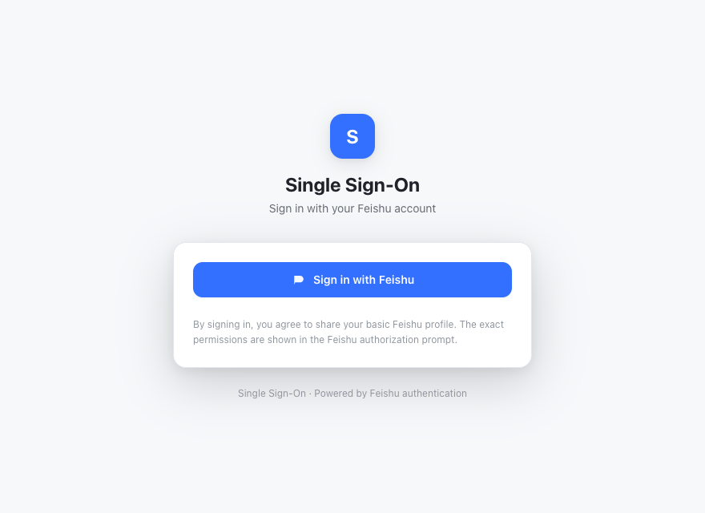
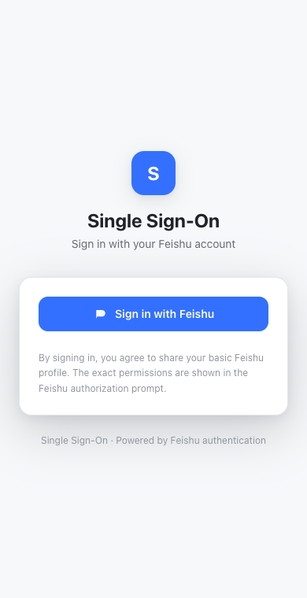
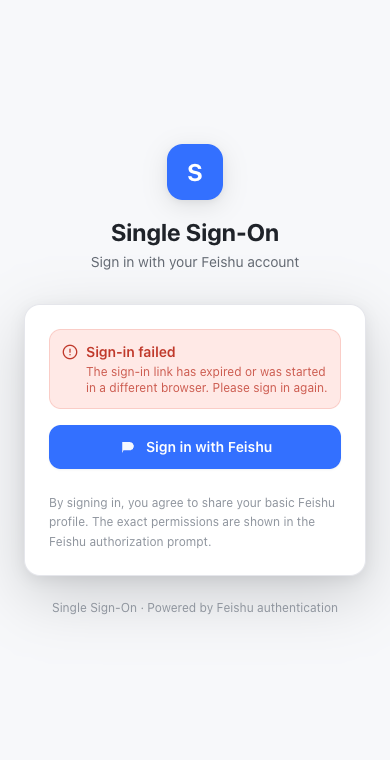
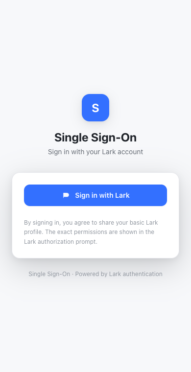
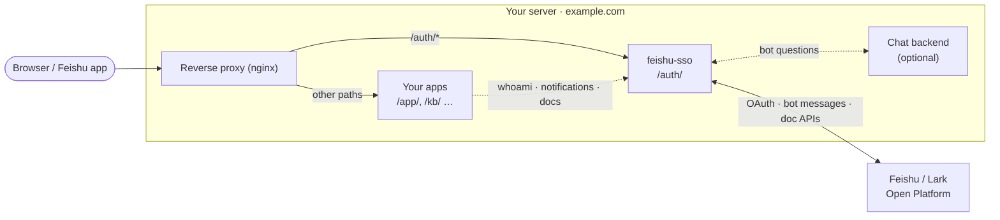
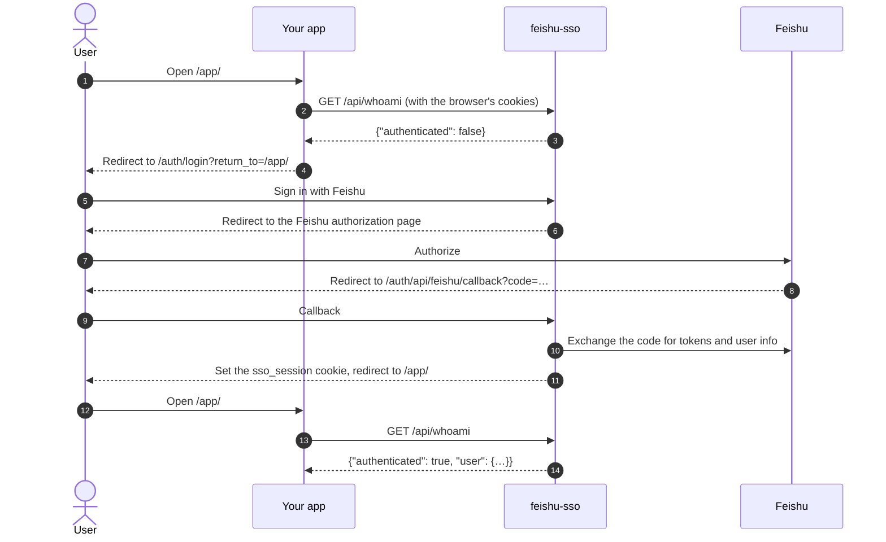
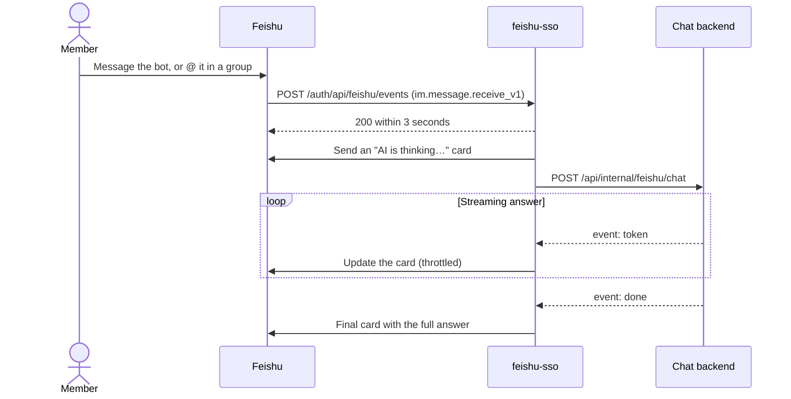

# feishu-sso

English | [简体中文](README-CN.md)

Single sign-on with Feishu (Lark) for your self-hosted web apps. Users authorize once on the login page, and every app on the same host can get the current user from `whoami`. It also bundles the Feishu capabilities that integrating apps commonly need, so business apps don't each have to hold Feishu credentials.



## Features

- **Feishu login**: OAuth authorization with 30-day sliding sessions; signs in automatically when opened inside the Feishu app
- **Identity lookup**: `GET /auth/api/whoami` returns the current user (name, avatar, email, phone number, etc.)
- **Notifications**: business services send cards as the bot to a person or a group, authenticated by a shared token
- **Read Feishu docs**: read Docs, Wiki, Base (Bitable), Sheets and Whiteboards as the signed-in user, with Feishu enforcing permissions
- **Feishu bot (optional)**: ask the bot in a direct message or by @-mentioning it in a group, and it streams the answer into a card; answers come from a chat backend you connect
- **Chinese / English**: the login page follows the browser language and accepts `?lang=zh|en`; bot messages are switched with `BOT_LANG`
- **Feishu and Lark**: Feishu (China) by default, Lark (international) with `FEISHU_DOMAIN=lark`

| On a phone | Sign-in failed | Lark |
| :---: | :---: | :---: |
|  |  |  |

Tech stack: Fastify + Prisma (SQLite) backend, React + Vite + Tailwind login page, managed as a pnpm workspace.

## How it works

feishu-sso runs on the same host as your apps. The reverse proxy sends `/auth/*` to it and everything else to your apps, so all of them share the login cookie.



The login flow, as seen by an integrating app:



Inside the Feishu app, the login page starts authorization by itself, so users only see a brief redirect.

## Quick start

You need Node.js ≥ 20.19 (22 or 24 recommended), pnpm 9, and a Feishu custom app (see "Create a Feishu app" below).

```bash
pnpm install     # install dependencies and generate the Prisma client
pnpm bootstrap   # copy api/.env.example → api/.env.dev, generate AUTH_DATA_KEY, create the local SQLite database
# edit api/.env.dev and fill in FEISHU_APP_ID and FEISHU_APP_SECRET
pnpm dev         # start the api (:4020) and the login page (:5020)
```

Open <http://localhost:5020/auth/login>, click "Sign in with Feishu" and finish authorization, then visit <http://localhost:5020/auth/api/whoami> to see your user info.

The login page always lives under `/auth/` and the API under `/auth/api/*`. In local development Vite forwards `/auth/api/*` to the api's `/api/*`, the same as the reverse proxy in production.

The database is `api/prisma/dev.db` and is ignored by git. Feishu access and refresh tokens are encrypted with `AUTH_DATA_KEY` before they are stored.

## Commands

| Command | Purpose |
| --- | --- |
| `pnpm dev` | Local development |
| `pnpm build` | Build the api (`api/dist`) and the login page (`web/dist`) |
| `pnpm typecheck` | Type-check all packages |
| `pnpm test` | Run all unit tests |
| `pnpm --filter @feishu-sso/api db:migrate` | Create and apply a migration after editing `api/prisma/schema.prisma` |

## Create a Feishu app

Create a **Custom App** on the [Feishu Open Platform](https://open.feishu.cn/app) (Lark: [Lark Open Platform](https://open.larksuite.com/app)). The console labels below are the ones shown in the Chinese console.

1. **Credentials**: copy the App ID and App Secret from the credentials page (凭证与基础信息) into `FEISHU_APP_ID` and `FEISHU_APP_SECRET`.
2. **Web app and redirect URL**: add the web app capability (应用能力 → 网页应用), then register the callback URL under security settings (安全设置 → 重定向 URL). It must match `FEISHU_REDIRECT_URI` exactly, including scheme, port and path:
   - Local development: `http://localhost:5020/auth/api/feishu/callback`
   - Production: `https://<your-domain>/auth/api/feishu/callback`
3. **Scopes**: enable the scopes listed in `FEISHU_SCOPES` under permission management (权限管理). Login alone only needs `contact:user.base:readonly`; enable email, phone number, doc reading and so on as needed and update `FEISHU_SCOPES` to match.
4. **Release**: create and publish a version (版本管理与发布) and wait for the tenant admin to approve it; scope changes also need a new version. Add the members who should be able to sign in to the app's availability (可用范围).

When `FEISHU_SCOPES` gains scopes the user did not have at their last login, signed-in users are asked to sign in once more to grant them.

For **Lark**, set `FEISHU_DOMAIN=lark`: the authorization page moves to `passport.larksuite.com` and the Open API to `open.larksuite.com`, with the same paths and settings as Feishu.

## Configuration

The api loads configuration with Node's built-in `--env-file`: `pnpm dev` reads `api/.env.dev` and `pnpm start` reads `api/.env.prod`. Neither is committed; the template is [`api/.env.example`](api/.env.example).

| Variable | Default | Description |
| --- | --- | --- |
| `FEISHU_DOMAIN` | `feishu` | `feishu` for Feishu (China), `lark` for Lark (international) |
| `FEISHU_APP_ID` / `FEISHU_APP_SECRET` | — | App credentials, required |
| `FEISHU_REDIRECT_URI` | — | Authorization callback URL; must match the one registered in the developer console. Required |
| `FEISHU_SCOPES` | empty | Requested scopes, space-separated |
| `AUTH_DATA_KEY` | — | Token encryption key (32 bytes, base64), generated by `pnpm bootstrap`. Generate a separate one for production and keep it safe; if it is lost, signed-in users have to sign in again |
| `DATABASE_URL` | — | SQLite path; relative paths are resolved from `api/prisma/`. Use an absolute path in production |
| `HOST` / `PORT` | `127.0.0.1` / `4020` | Address the api listens on |
| `TRUST_PROXY` | `loopback` | Which reverse proxies to trust for `X-Forwarded-*` headers, passed to Fastify `trustProxy`: `loopback`, comma-separated IPs / CIDRs, or `true` / `false`. Hop counts are not supported; a number fails at startup. Per-client rate limiting depends on it; set it to nginx's address when nginx runs on another machine |
| `SITE_NAME` | empty | Site name shown in the login page title and footer; when empty the page shows "统一登录" or "Single Sign-On" depending on the UI language |
| `ASSISTANT_NAME` | `AI` | How the assistant is called in bot cards |
| `BOT_LANG` | `zh` | Language of bot cards and button toasts: `zh` or `en`. The server cannot see the asker's UI language, so the deployer chooses |
| `SESSION_COOKIE_NAME` | `sso_session` | Login cookie name; integrating apps read this name by default |
| `SESSION_COOKIE_DOMAIN` | empty | Empty = current host only; set `.example.com` to share the login across subdomains |
| `SESSION_COOKIE_SECURE` | `false` in development, `true` otherwise | Keep `true` for HTTPS deployments |
| `SESSION_REMEMBER_TTL_DAYS` | `30` | Logins from the login page are always "remember me"; this sets their lifetime |
| `SESSION_TTL_DAYS` | `30` | Short session lifetime, only used when a caller explicitly passes `remember_me=0` |
| `SESSION_SLIDING` | `true` | Sliding sessions: when on, a session only expires after this many days of inactivity |
| `SESSION_COOKIE_SAMESITE` | `lax` | SameSite of the login cookie; `none` also requires `SESSION_COOKIE_SECURE=true` |
| `STATE_TTL_SECONDS` | `300` | How long a login attempt's state is valid, in seconds |
| `REFRESH_LOOKAHEAD_MINUTES` / `REFRESH_INTERVAL_MINUTES` | `10` / `30` | Background Feishu token refresh: how many minutes before expiry to refresh, and how often to scan |
| `ALLOWED_RETURN_TO` | empty | Addresses on **other hosts** allowed after login (regexes, space-separated). Same-origin paths and absolute URLs on the request's own origin are always allowed; anything else falls back to `/auth/` to prevent open redirects |
| `CORS_ORIGINS` | empty | Frontend origins allowed to call whoami / logout cross-origin, space-separated. Leave empty for same-host deployments |
| `INTERNAL_API_TOKEN` | development placeholder | Shared secret between services, see "APIs for integrating apps". Startup is refused if it is still the placeholder in production or on a non-loopback `HOST`; empty disables the internal APIs |
| `FEISHU_EVENT_ENCRYPT_KEY` / `FEISHU_EVENT_VERIFICATION_TOKEN` | empty | Encryption and verification of bot events, see "Optional: Feishu bot" |
| `BOT_BACKEND_URL` | not set | Chat backend URL for the bot (a trailing `/` is removed) |
| `WEB_DIST_DIR` | not set | Single-port mode: the api also serves the login page from this directory and accepts the `/auth/api/*` prefix. Set in the Docker image; leave empty when nginx serves the login page |

## Integrate your app

Integrating apps must be served from the same host as this service, with the reverse proxy forwarding `/auth/*` here (see "Deployment"), so they can read the login cookie. On the app side, an integration usually needs just two settings:

- Backend: the whoami address, `http://127.0.0.1:4020/api/whoami` (called server to server, bypassing the reverse proxy)
- Frontend: the login base path, `/auth`

Then follow these conventions:

| Scenario | How |
| --- | --- |
| Sign in | Redirect to `/auth/login?return_to=<address to return to after login>` (see below for `return_to`); add `&lang=zh` or `&lang=en` to match your app's UI language |
| Current user | From your backend, forward the browser's cookies unchanged to `GET /api/whoami`; it returns `{"authenticated": false}` or `{"authenticated": true, "user": {...}, "session": {...}}` |
| Sign out | From the browser, `POST /auth/api/logout` (with cookies) |

**`return_to` rules** (the address used after login; anything else falls back to `/auth/`):

1. A same-origin path such as `/kb/doc?id=1` (a single leading `/`, no whitespace, control characters or backslashes).
2. **An absolute URL on the same origin as the request**, such as `https://kb.example.com/kb/doc?id=1`: scheme, host and port must match how the browser reached this service. The origin is reconstructed from the `X-Forwarded-Proto` / `X-Forwarded-Host` set by the reverse proxy (`TRUST_PROXY` must trust that proxy; the nginx snippet sets both headers). Integrating apps can simply pass `window.location.href` without configuring `ALLOWED_RETURN_TO`.
3. Addresses on other hosts, only when they match `ALLOWED_RETURN_TO`.

The `session.id` returned by `whoami` is an irreversible display identifier, not the cookie value, and cannot be used to impersonate a session.

For local integration, set the integrating app's web to `VITE_SSO_BASE=http://localhost:5020/auth` and put its development origin (e.g. `http://localhost:5070`) in this service's `CORS_ORIGINS`. Browser cookies ignore the port, so different ports on `localhost` share the login.

## APIs for integrating apps

These endpoints are called by business services' backends with the header `x-internal-token: <INTERNAL_API_TOKEN>`, configured to the same value on both sides. Messages are sent as the bot, which requires the bot capability and the `im:message:send_as_bot` scope.

| Endpoint | Purpose |
| --- | --- |
| `POST /api/feishu/notify` | Send a card to a person (`openId`) or a group (`chatId`) |
| `POST /api/feishu/reply` | Reply to a message, quoting it |
| `POST /api/feishu/reaction` | Add an emoji reaction to a message |
| `POST /api/feishu/upload-image` | Upload an image and get an `image_key` usable in cards |

Request formats are at the end of [docs/bot-backend.md](docs/bot-backend.md).

These endpoints are only for business services on the same machine: both the nginx snippet and single-port mode return 404 for them publicly, so call `http://127.0.0.1:4020/api/feishu/<name>` directly (not through the domain). When `INTERNAL_API_TOKEN` is empty, all four reject every request.

The doc-reading endpoints act as the **signed-in user** (send the user's login cookie, no token needed), so only documents the user can view in Feishu are readable: `/api/feishu/docx/:documentId`, `/api/feishu/docx/:documentId/blocks`, `/api/feishu/wiki/node?token=`, `/api/feishu/media/:fileToken`, `/api/feishu/board/:whiteboardId/{image,nodes}`, `/api/feishu/bitable/:appToken/:tableId/{fields,records}`, `/api/feishu/sheet/:sheetToken/:sheetId/values`. The matching read scopes must be enabled and listed in `FEISHU_SCOPES`. Failures return distinguishable error codes: `need_relogin`, `feishu_need_reauth`, `feishu_scope_disabled`, `feishu_permission`, `feishu_upstream`.

## Optional: Feishu bot

When a member messages the bot directly or @-mentions it in a group, the bot first replies with an "AI is thinking…" card (rename it with `ASSISTANT_NAME`, switch the language with `BOT_LANG`) and then streams the full answer into it. This service only sends and receives messages; answers come from a chat backend you connect, which also decides which model to use. The protocol is in [docs/bot-backend.md](docs/bot-backend.md).



Without `BOT_BACKEND_URL`, the bot answers every question with "not connected to a chat backend yet"; login and the other features are unaffected.

Developer console setup (use the same app as login, otherwise senders' open_ids won't match):

1. **Enable the bot**: add the bot capability (应用能力 → 机器人).
2. **Scopes**:
   - `im:message`, `im:message:send_as_bot`: send and receive messages
   - `im:message.group_at_msg:readonly`: receive group messages that @-mention the bot
   - `im:resource`: send and receive images
   - `im:message.group_msg` (optional, sensitive): receive all group messages; only needed if the chat backend listens to group conversations
   - `im:message.reactions:write_only` (optional): add emoji reactions
3. **Event subscription**: under events and callbacks (事件与回调 → 事件订阅), choose sending events to the developer's server (将事件发送至开发者服务器), set the request URL to `https://<your-domain>/auth/api/feishu/events`, and add the event `im.message.receive_v1`.
4. **Callback subscription**: under 事件与回调 → 回调订阅, use the same URL and add the callback `card.action.trigger`. Without it, buttons on cards do nothing.
5. **Encryption**: copy the Encrypt Key and Verification Token from the encryption strategy page (加密策略) into `FEISHU_EVENT_ENCRYPT_KEY` and `FEISHU_EVENT_VERIFICATION_TOKEN`. In production, if neither is set, all events are rejected to prevent forgery.
6. **Publish a new version** and add the bot to the groups where it should be used.

Local debugging needs no public URL: `api/scripts/sim-feishu-event.mjs` sends a simulated message to the local receiver (usage at the top of the file), and the answer card really appears in the given Feishu chat.

## Deployment

This service must share a host with the integrating apps (so the login cookie is shared), with the integrating site's reverse proxy forwarding `/auth/` to it. Choose one of the two options.

### Option 1: source + systemd + nginx

`deploy/` contains a systemd template and an nginx snippet. The nginx snippet goes inside the integrating site's `server { }` block:

```bash
git clone <repo> /opt/feishu-sso && cd /opt/feishu-sso
pnpm install && pnpm build
cp api/.env.example api/.env.prod   # keep TRUST_PROXY=loopback for nginx on the same machine; set NODE_ENV=production, an absolute DATABASE_URL, the Feishu credentials, and freshly generated AUTH_DATA_KEY and INTERNAL_API_TOKEN
pnpm --filter @feishu-sso/api db:migrate:prod

sudo cp deploy/systemd.service.template /etc/systemd/system/feishu-sso.service
sudo sed -i 's|__INSTALL_DIR__|/opt/feishu-sso|g; s|__SERVICE_USER__|www-data|' /etc/systemd/system/feishu-sso.service
sudo systemctl daemon-reload && sudo systemctl enable --now feishu-sso

sudo cp deploy/nginx-locations.conf.template /etc/nginx/snippets/feishu-sso.conf
sudo sed -i 's|__INSTALL_DIR__|/opt/feishu-sso|' /etc/nginx/snippets/feishu-sso.conf
# add one line to the integrating site's server { } block: include /etc/nginx/snippets/feishu-sso.conf;
sudo nginx -t && sudo systemctl reload nginx
```

In production set `FEISHU_REDIRECT_URI` to `https://<your-domain>/auth/api/feishu/callback` and register it in the developer console. The service user needs write access to the directory of `DATABASE_URL`.

### Option 2: Docker

In the image the api also serves the login page (`WEB_DIST_DIR`) and applies database migrations on startup; data lives in the `feishu-sso-data` volume. The port is bound to this machine only:

```bash
cp api/.env.example api/.env.prod   # fill in the Feishu credentials and freshly generated AUTH_DATA_KEY and INTERNAL_API_TOKEN; HOST, PORT, DATABASE_URL and TRUST_PROXY are set by docker-compose.yml
docker compose up -d --build
```

Then forward `/auth/` to it from the integrating site's nginx `server { }` block:

```nginx
location /auth/ {
    proxy_pass http://127.0.0.1:4020;
    proxy_http_version 1.1;
    proxy_set_header Host              $host;
    proxy_set_header X-Forwarded-Host  $host;
    proxy_set_header X-Forwarded-For   $remote_addr;
    proxy_set_header X-Forwarded-Proto $scheme;
}
```

The login cookie is `Secure` in production, so serve the site over HTTPS. Business services and the chat backend on the same machine call `http://127.0.0.1:4020/api/...` directly.

### Upgrading

After `git pull`, run `pnpm install && pnpm build`, apply migrations with `pnpm --filter @feishu-sso/api db:migrate:prod`, and restart the service. With Docker, `docker compose up -d --build` rebuilds the image and applies migrations on startup.

## Security

Please do not report security issues in public issues; see [SECURITY.md](SECURITY.md). Before deploying, make sure `AUTH_DATA_KEY` and `INTERNAL_API_TOKEN` are freshly generated strong random values, `api/.env.prod` is not committed, and in production the bot events have an Encrypt Key or Verification Token configured.

## Project layout

```
api/        Fastify backend: Feishu OAuth, sessions, whoami, doc gateway, notification APIs, bot events
web/        Login page (Chinese / English, strings in web/src/i18n/messages.ts)
packages/   Shared packages (Feishu SDK wrapper, token encryption, identity types, skin tokens, Tailwind preset, ...)
deploy/     systemd template and nginx snippet
docs/       Chat backend protocol for the bot, README screenshots
```

## License

[MIT](LICENSE)
